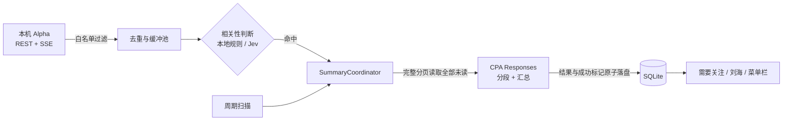

<div align="center">


# 群岛 Qundao

**替你留意，安心专注。**

一款原生 macOS 群聊办公助手：从繁忙的工作群里，只把与你有关的内容递到眼前。


</div>

---

## 为什么是群岛

工作群消息多、节奏快，真正需要你回应的往往只有几条。群岛在后台监听你指定的群聊，识别 @你、点名请求和与你职责相关的讨论，生成摘要后统一放进「需要关注」，并在屏幕刘海处轻量提醒。

- 🎯 **只看相关**：@我、@所有人、称呼、关键词与语义匹配，再由模型结合上下文确认。
- 🏝️ **刘海面板**：参考 Vibe Island 的交互方向，收起时不打扰，展开即读。
- 🧾 **完整摘要**：摘要时读取该群当时全部未读，超长内容完整分段再汇总，不静默截断。
- 🔒 **白名单优先**：只处理你明确加入的群；私聊和白名单外群聊在入口直接丢弃。
- 🙅 **只读不打扰**：不自动回复、不发送消息、不改变聊天平台的已读状态。

## P5 风格刘海

红黑撞色、斜切卡片和剪报字标，让需要关注的内容一眼可见：

- **收起**：贴着摄像头的一条黑色，左侧徽记显示处理阶段，右侧显示待阅数量
- **展开**：悬停即展开，点击固定；顶部状态条实时显示「缓冲 → Jev → CPA」
- **插播**：有新的找你内容时，横幅「有人找你！」切入
- **已阅**：悬停卡片翻黑，点「本群已阅」斜切移除；「一键已阅」逐张退场
- 支持「减少动态效果」，动画会自动收敛

> 演示来自 [prototype/刘海P5风.html](prototype/刘海P5风.html) 高保真原型，内容均为合成数据。

## 功能一览

| 模块 | 说明 |
| --- | --- |
| 需要关注 | 所有相关内容的唯一入口，左侧选群、右侧阅读摘要卡片，点击查看本批原文 |
| 群聊摘要 | 白名单群的摘要列表，按最新未读时间倒排，未读群优先 |
| 监听群聊 | 白名单表格，支持搜索、排序、多选移出；添加窗口直接列出全部可添加群 |
| 关键词与规则 | 称呼、群昵称、负责事项；可选「本地识别」或「Jev 决策模型」 |
| 刘海与通知 | 收起 / 展开宽度可调，动画尊重「减少动态效果」，系统通知按需授权 |
| 连接与模型 | 消息来源 Alpha、摘要模型 CPA、Jev 服务的地址、协议与密钥 |
| 运行日志 | 实时刷新、跟随最新、来源筛选、分页与归档 |

「已阅」「本群已阅」「一键已阅」只更新群岛本地记录，批量操作固定在点击时的范围，不会提前标记之后新到的内容。

## 工作原理



1. **入口过滤**：仅当前账号白名单群的消息会进入后续流程，其余不缓存、不调用模型、不记录原文。
2. **缓冲判断**：消息去重后进入缓冲池，默认累计 30 条或首条等待 3 秒批量判断；后到消息不会无限延后截止时间。
3. **统一调度**：即时与周期只是触发来源，共用一个任务池。同群串行、跨群有限并发（默认 3，可设 1–8），即时任务优先。
4. **完整摘要**：执行时固定该群全部未读快照；与上次成功摘要的末条一致则跳过，不重复调用模型。
5. **可靠落盘**：摘要、原文证据和成功标记一起原子写入；失败、取消或输出无效都不会推进标记，并按 10 秒起、最长 5 分钟退避重试。

## 快速开始

**环境要求**：macOS 14+、Xcode（Swift 5.10+）、本机运行的 Alpha 消息服务。

```bash
git clone https://github.com/kiliter/qundao.git
cd qundao

# 运行测试
swift test --scratch-path .build

# 构建并签名 .app
./script/build_and_run.sh --build-only

# 停止旧进程，安装到 /Applications/群岛.app 并启动
./script/build_and_run.sh --verify
```

脚本复用本机固定的开发签名身份，不会创建临时证书或修改系统信任。换机器时用 `QUNDAO_SIGNING_IDENTITY` 指定证书指纹。

### 首次使用

1. 打开「连接与模型」，填写 Alpha 访问令牌并连接。
2. 填写 CPA API Key（或从 Codex 导入），点击「保存并获取模型」。
3. 在「关键词与规则」填写姓名、群昵称和负责事项。
4. 在「监听群聊」点击「添加群聊」，勾选需要关注的群，开始监听。
5. 需要系统通知时，在「刘海与通知」主动开启授权。

## 模型接入

**CPA 摘要**：使用 OpenAI 风格的 Responses API（`/v1/responses`，`store:false`，无工具调用），通过兼容 `model_catalog_url` 的方式读取模型目录与上下文预算。

**Jev 决策**：TypeSafe 的决策模型，为每条消息给出「与我相关」「需要我回应」两个概率，默认阈值 75%。

| 服务 | Base URL | 协议 | 默认模型 |
| --- | --- | --- | --- |
| OpenRouter | `https://openrouter.ai/api` | Decisions API | `~typesafe/jev-latest` |
| TypeSafe | `https://api.typesafe.ai/v1` | System One API | `jev-latest` |

支持自定义 Base URL、代理路径和独立密钥，界面显示最终请求地址；配置在点击保存后统一生效。

## 数据与隐私

| 内容 | 位置 |
| --- | --- |
| 配置与密钥 | `~/.config/qundao/config.toml`（目录 700、文件 600，外部修改自动重载） |
| 运行数据 | `~/Library/Application Support/Qundao/qundao.sqlite`（WAL） |
| 运行日志 | `~/Library/Application Support/Qundao/Logs/`，按日写入，超 10 MB 滚动归档 |

- 普通运行日志不记录聊天正文，群与消息使用脱敏引用。
- 诊断日志会保留白名单群内的原文及模型入参、出参，用于排查判断依据，界面中有明确说明；鉴权头和密钥不会写入日志。
- 聊天正文与模型返回一律视为待分析数据，不会被当作指令执行。

## 项目结构

```text
Sources/
├── QundaoCore/        # 业务核心：Alpha / CPA / Jev 客户端、调度、规则、持久化
└── Qundao/
    ├── App/           # 应用入口
    ├── Stores/        # 状态协调
    ├── Services/      # 系统服务（刘海窗口、通知等）
    └── Views/         # SwiftUI 视图
Tests/QundaoCoreTests/ # 合成消息与模拟传输测试
prototype/             # 高保真 HTML 交互原型
wiki/                  # 产品规则、架构流程、接口与决策记录
docs/                  # 各版本验收记录
script/                # 构建、签名与安装脚本
```

## 文档

- [项目 Wiki](wiki/README.md)：产品规则、消息与摘要流程、接口、界面、数据日志与决策记录
- [AGENTS.md](AGENTS.md)：开发协作约定、隐私边界与验证要求
- [docs/](docs/)：各版本验收记录

## 当前状态

122 项自动化测试中 118 项通过，4 项需要真实服务密钥的集成测试默认跳过（通过环境变量 `QUNDAO_TEST_CPA_KEY`、`QUNDAO_TEST_ALPHA_TOKEN` 注入后启用）。模拟测试通过不等于真实接口验收；Jev 真实判断准确率、长文本分层汇总质量、长时间运行与跨休眠行为仍在持续验收中。
